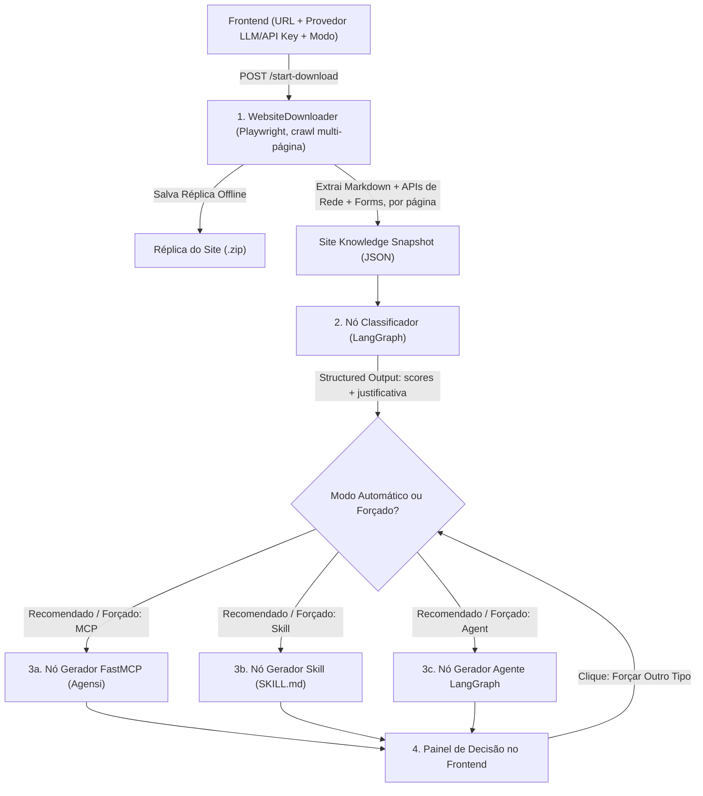

# Website Downloader + Fábrica de Agentes, Skills e MCP (LangChain & LangGraph)

Status: aprovado pelo usuário para implementação completa (sem cortes de escopo), após discussão de alternativas mais simples.

## Objetivo

Expandir o Website Downloader para que, além de baixar a réplica estática funcional de um site, ele extraia o conhecimento do site e gere automaticamente um dos três formatos consumíveis por IA — **Skill**, **Agente LangGraph** ou **Servidor MCP (FastMCP)** — com a decisão de formato feita por um classificador em LangGraph, 100% configurável pelo Frontend (provedor de LLM, modelo, API key, modo de operação).

## Gap crítico descoberto antes da implementação

O `WebsiteDownloader` atual (`downloader.py`) baixa **apenas a página única informada na URL** — não há crawling de links internos (`process()` abre uma página, captura recursos daquela página e encerra). Isso foi confirmado testando contra `https://www.risingtale.com/wiki.html`: o resultado trouxe só a página "Wiki" (shell), sem as subpáginas de itens/monstros/mapas/skills.

Sem resolver isso, qualquer classificador/gerador rodaria sobre o conhecimento de 1 página só, o que invalida o objetivo do pipeline para sites com mais de uma página (a maioria dos casos reais, incluindo o motivador original deste projeto).

**Requisito adicionado ao escopo**: o `WebsiteDownloader` precisa de uma etapa de **crawl multi-página** (fila de URLs a visitar, mesmo domínio, limite de profundidade/páginas configurável) antes da extração de conhecimento, mantendo o comportamento atual de captura de assets por página.

## Decisões de Design

- **Configuração 100% pelo Frontend**: usuário escolhe provedor de LLM (OpenAI, Google Gemini ou Anthropic), modelo e API key na interface, com persistência opcional em `localStorage` e fallback para `.env`.
- **Reaproveitamento instantâneo de sessão**: forçar outro formato (MCP ⇄ Skill ⇄ Agent) reexecuta só o nó gerador correspondente sobre o conhecimento já extraído em disco/memória, sem rebaixar o Chromium.
- **Crawl multi-página**: necessário para que o conhecimento extraído cubra o site inteiro, não só a página de entrada (ver gap acima).

## Arquitetura do Fluxo (LangGraph)



## Mudanças Propostas

### 1. Dependências do Projeto

`pyproject.toml` / `requirements.txt` — adicionar (já presentes no estado atual do repo, uncommitted):

```toml
dependencies = [
    "beautifulsoup4>=4.14.3",
    "flask>=3.1.2",
    "gunicorn>=21.2.0",
    "playwright>=1.57.0",
    "psutil>=5.9.8",
    "requests>=2.32.5",
    "pydantic>=2.10.0",
    "markdownify>=0.14.1",
    "langchain>=0.3.20",
    "langchain-core>=0.3.40",
    "langgraph>=0.3.5",
    "langchain-openai>=0.3.7",
    "langchain-google-genai>=2.0.11",
    "langchain-anthropic>=0.3.8",
]
```

### 2. Extração de Conhecimento, APIs e Crawl no Downloader

`downloader.py`:

- **Crawl multi-página (novo)**: fila de URLs descobertas via links internos (`<a href>`), mesmo domínio/subdomínio de origem, com limite configurável de páginas e profundidade (defaults sensatos, ex. 200 páginas / profundidade 5, ajustável). Cada página visitada passa pelo mesmo pipeline de captura de assets já existente.
- **Interceptação de APIs de rede (`self.captured_apis`)**: no callback `capture_response`, registrar chamadas `xhr`/`fetch`/respostas `application/json`, ignorando analytics/trackers conhecidos (GA, Clarity, Hotjar, Facebook Pixel). Para cada endpoint: método HTTP, URL limpa, query params, amostra truncada do JSON (chaves e tipos).
- **Extração de conhecimento limpo (`_extract_site_knowledge(soup)`)**, por página: metadados (`title`, `description`, `og:*`, JSON-LD, `__NEXT_DATA__`), corpo convertido em Markdown estruturado por seções, formulários/inputs mapeados, links internos. Agregado em `self.site_knowledge` por URL e salvo em `site_knowledge.json` na pasta da sessão.

### 3. Motor LangChain & LangGraph (`agent_factory.py`)

Já existe no repo (uncommitted, 985 linhas) implementando:

1. `create_llm(provider, model, api_key)` — factory multi-provider (OpenAI/Gemini/Anthropic).
2. Schemas Pydantic: `ClassificationResult`, `MCPServerSpec`, `SkillSpec`, `AgentSpec` com `with_structured_output`.
3. `build_site_to_ai_graph()`:
   - `classify_site_node`: analisa `site_knowledge.json` agregado (agora multi-página) e produz `recommended_type` (`mcp`/`skill`/`agent`), `scores` (0-100 cada), `reasoning` em português, `capabilities`.
   - `generate_mcp_node`: pacote `server.py` (FastMCP, tools tipadas Pydantic, `@mcp.resource("site://knowledge")`), `pyproject.toml`, `.env.example`, `agensi.json`, `README.md`.
   - `generate_skill_node`: `SKILL.md` (frontmatter YAML), `references/knowledge_base.md`, `scripts/search_knowledge.py`.
   - `generate_agent_node`: `agent.py` (StateGraph/ReAct com ferramentas de busca e requisição às APIs descobertas), `knowledge.json`, `pyproject.toml`, `README.md`.
4. `chat_with_site_knowledge(session_state, user_message)` — runtime de chat de teste.

**Verificação necessária na implementação**: confirmar que o classificador e os geradores consomem o `site_knowledge.json` agregado de todas as páginas do crawl (não só a página raiz), já que esse é o gap identificado acima.

### 4. Rotas de API e Streaming (`app.py`)

Já existentes no repo (uncommitted):

- `POST /start-download` — `{ url, provider, model, api_key, forced_type, login_email?, login_password? }`, `forced_type` ∈ `auto|mcp|skill|agent|replica_only`. Roda download (agora com crawl) + zip da réplica + grafo LangGraph com progresso via fila/SSE.
- `GET /session-result/<session_id>` — status, decisão do LangGraph, preview de arquivos gerados, stats (apis/forms/headings/links/páginas crawleadas).
- `POST /generate-type/<session_id>` — força outro formato reusando o snapshot da sessão.
- `GET /download-artifact/<session_id>/<kind>` — `kind` ∈ `replica|mcp|skill|agent`.
- `POST /chat/<session_id>` — chat de teste contra o conhecimento/agente da sessão.

### 5. Frontend (`templates/index.html`)

Já existente no repo (uncommitted, reescrita de ~1000 linhas):

- Barra de configuração de IA (provedor/modelo/API key) + seletor de modo (`auto`, forçar MCP/Skill/Agent, `replica_only`).
- Terminal de progresso em tempo real (SSE) cobrindo download/crawl e raciocínio do LangGraph.
- Painel de Decisão: veredito, scores comparativos, reasoning, capabilities detectadas, botões para forçar outro formato.
- Visualizador de código gerado (abas, copiar), downloads independentes (réplica / artefato IA), aba de chat de teste.

## Plano de Verificação

1. `uv sync` com as novas dependências.
2. Subir `uv run python app.py` (porta 5001).
3. Testar contra `https://www.risingtale.com/wiki.html`:
   - Crawl multi-página captura as subpáginas de categoria (itens, monstros, mapas, skills, etc.), não só a raiz.
   - `site_knowledge.json` agregado reflete múltiplas páginas.
   - Classificação do LangGraph e Painel de Decisão renderizam corretamente.
   - Forçar manualmente MCP, Skill e Agent pela UI gera os três pacotes.
   - `python -m py_compile` nos `server.py`/`agent.py` gerados.
4. Comparar o resultado do pacote **Skill** gerado automaticamente com a skill `risingtale-wiki` já existente em `.claude/skills/risingtale-wiki/` (gerada por outra ferramenta) como referência de qualidade/cobertura.

## Fora de escopo (não incluído nesta spec)

- Qualquer redução do pipeline (classificador, multi-provider, 3 formatos) discutida e descartada durante o brainstorming — o usuário optou explicitamente por manter o plano completo.
